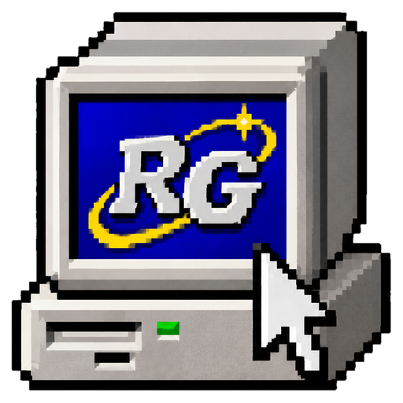
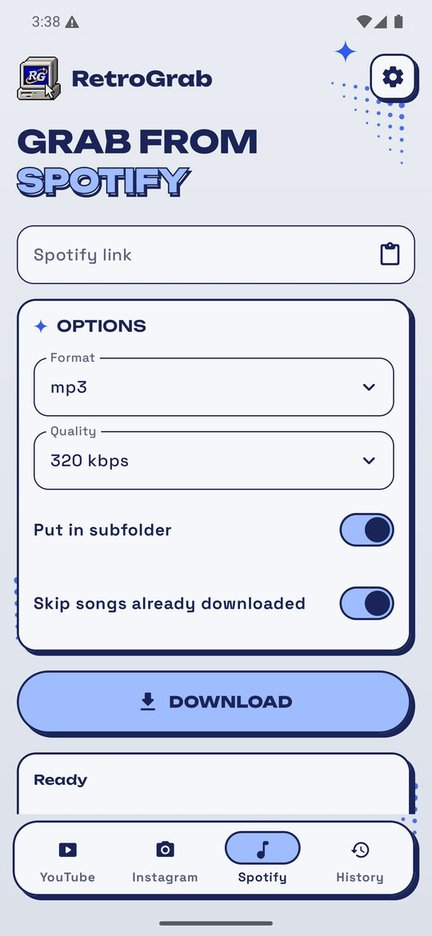
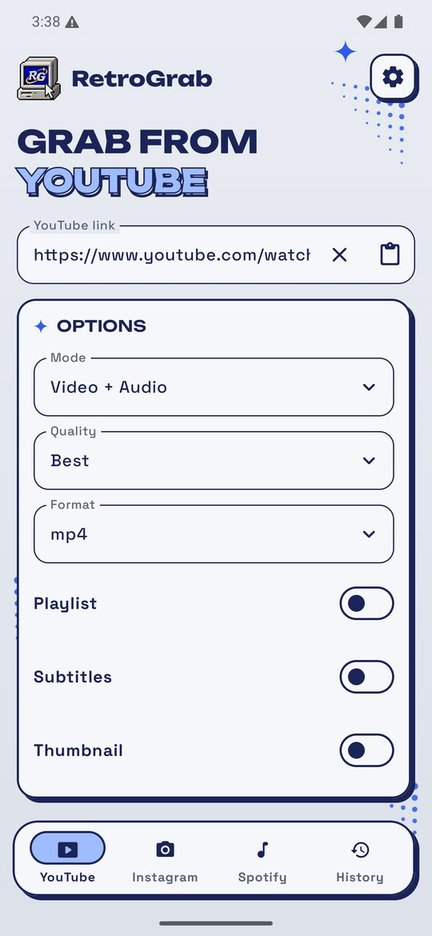
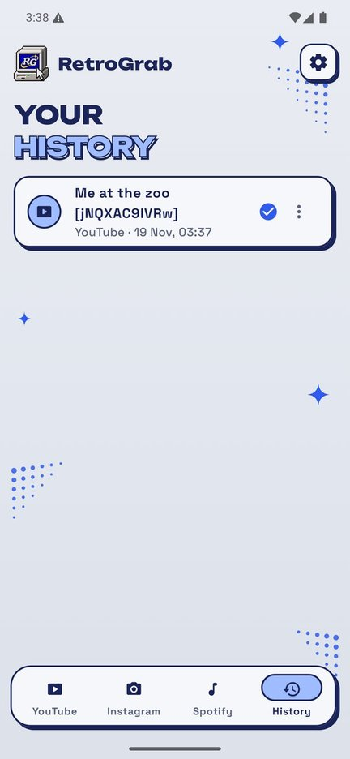
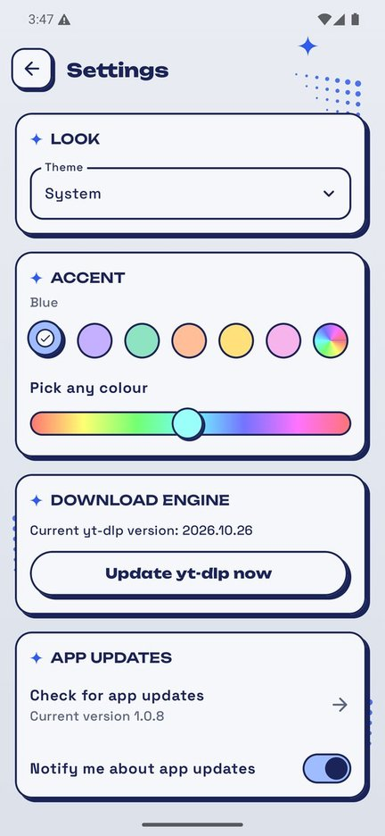
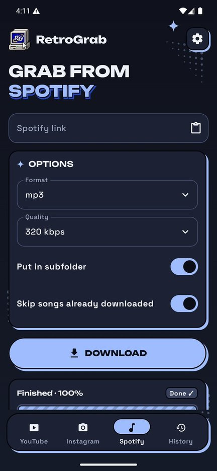
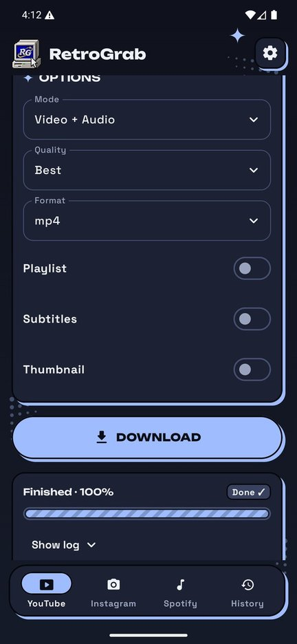
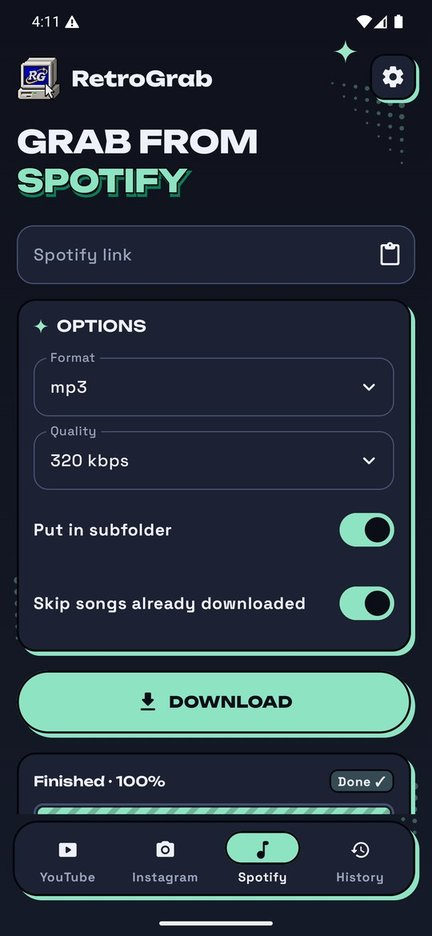
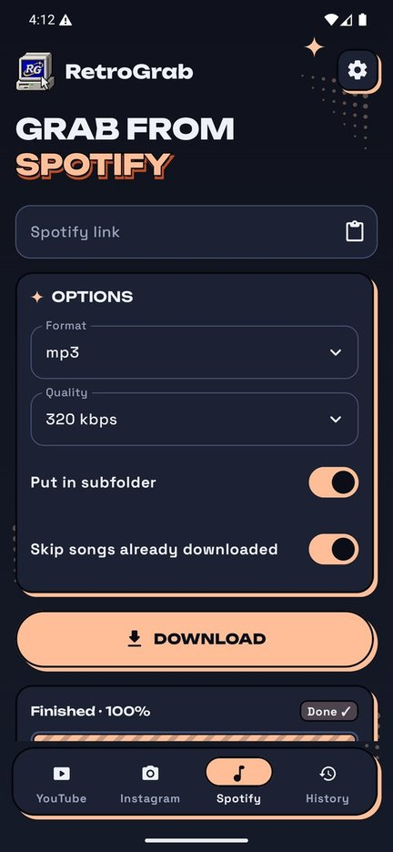

  

<h1 align="center">RetroGrab for Android</h1>

Download from <b>YouTube</b>, <b>Instagram</b> and <b>Spotify</b> links on your phone. 
Looking for the Windows app? → <a href="https://github.com/skandasandy24/RetroGrab">RetroGrab for PC</a>

## Screenshots

  
  
  
  

  
  
  
  

Light and dark mode, with six accent colours or any colour you pick.

## Download

Get the newest APK from **[Releases → Latest](https://github.com/skandasandy24/RetroGrab-Android/releases/latest)**:

| File | For |
|---|---|
| `RetroGrab-x.x.x-arm64-v8a.apk` | **Almost every phone from ~2017 on. Use this one.** |
| `RetroGrab-x.x.x-armeabi-v7a.apk` | Very old 32-bit phones (if the one above says "App not installed") |
| `RetroGrab-x.x.x-universal.apk` | Any phone, but about 3× bigger |

Requires Android 7 or newer.

### Installing
1. Open the APK. Android asks to allow installs from that app (Chrome, WhatsApp, Files…). Allow it, go back.
2. Tap **Install**. Google Play Protect may warn you (*App scan recommended* or *Harmful app blocked*).
   Tap **Install without scanning** / **Install anyway**. It flags video downloaders that aren't from the Play Store.
3. Open RetroGrab and allow notifications (download progress and update alerts).

### Using it
- In YouTube, Instagram or Spotify tap **Share → RetroGrab**. The link is filled in and the right tab opens. Tap **Download**.
- Videos go to `Movies/RetroGrab`, songs to `Music/RetroGrab`, photos to `Pictures/RetroGrab`.
- Private Instagram posts: Instagram tab → **Log in** (once).

### Updates
The app checks this repo's Releases and shows an alert when a new version is out: **Update** downloads and installs it in one tap.
History and settings are kept.

## Features
- **YouTube**: video + audio, audio only (MP3 / M4A / Opus) or video only, 360p to 4K, playlists, subtitles, thumbnails.
- **Instagram**: reels, posts and carousels; log in for private content (cookies stay on the phone).
- **Spotify**: songs, albums and playlists, matched on YouTube and saved as tagged MP3 / M4A. Spotify's own protected audio is never downloaded.
- Background downloads with a progress notification, download history, and yt-dlp that updates itself.
- Light and dark mode, six accent colours or any colour from the spectrum, and smooth animations.

## Building from source
Android Studio (or JDK 17 + Android SDK 35), then `gradlew assembleRelease` (Windows: `.\gradlew.bat assembleRelease`).
Release signing reads `keystore.properties` in the project root; it is not in this repo.

Publishing a release (maintainer): `.\release.ps1 -Version 1.0.4 -Notes "What changed" [-Level important|required]`.

---
Only download what you have the right to.
